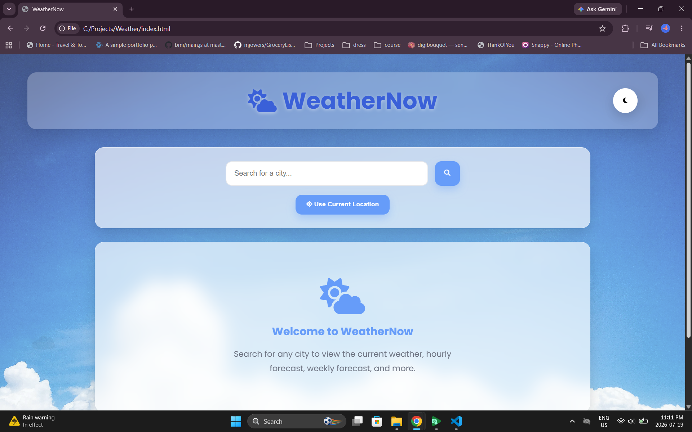

# 🌤️ WeatherNow

A modern, responsive weather application built using **HTML**, **CSS**, and **JavaScript** that provides real-time weather information for any city around the world using the OpenWeather API.

---

## 📸 Preview



---

## 🚀 Live Demo

https://hiral3026.github.io/Weather-Now-App/

---

## 📂 GitHub Repository

https://github.com/Hiral3026/Weather-Now-App.git

---

## ✨ Features

- 🔍 Search weather by city name
- 📍 Get weather using current location
- 🌡️ Current temperature
- 🌤️ Weather description
- 🖼️ Dynamic weather icons
- 🕒 Hourly forecast
- 📅 5-day weather forecast
- 💧 Humidity
- 🌬️ Wind Speed
- 👀 Visibility
- 🌡️ Feels Like temperature
- 📈 Atmospheric Pressure
- 🌅 Sunrise & Sunset time
- ☔ Chance of Rain
- 🌞 UV Index
- 🌙 Dark Mode
- 🎨 Dynamic backgrounds based on weather conditions
- 📱 Fully Responsive Design
- 💾 Theme preference saved using Local Storage
- ⌨️ Search using the Enter key
- 🏠 Click "WeatherNow" logo to return to the home screen

---

## 🛠️ Built With

- HTML5
- CSS3
- JavaScript (ES6)
- OpenWeather API
- Font Awesome
- Google Fonts (Poppins)

---

## 📁 Project Structure

```
WeatherNow/
│
├── index.html
├── style.css
├── script.js
│
├── images/
│   ├── background-1.jpg
│   ├── background-dark.jpg
│   ├── sunny.jpg
│   ├── rainy.jpg
│   ├── snow.jpg
│   ├── night.jpg
│   └── thunderstorm.jpg
│
└── README.md
```

---

## ⚙️ Installation

1. Clone the repository

```bash
git clone https://github.com/Hiral3026/Weather-Now-App.git
```

2. Open the project folder.

3. Open **index.html** in your browser.

---

## 🔑 API Setup

This project uses the **OpenWeather API**.

1. Create a free account at:

https://openweathermap.org/

2. Generate your API Key.

3. Open `script.js`

Replace

```javascript
const API_KEY = "YOUR_API_KEY";
```

with your own API key.

---

## 📖 How to Use

1. Enter a city name.

2. Click the Search button.

or

Press **Enter**.

or

Click **Use Current Location**.

The application displays:

- Current weather
- Hourly forecast
- 5-day forecast
- Weather details
- Additional weather information

Click the **WeatherNow** title to return to the welcome screen.

---

## 📱 Responsive Design

WeatherNow is optimized for:

- Desktop
- Laptop
- Tablet
- Mobile

---

## 🌙 Dark Mode

The application includes a Dark Mode.

- Theme preference is automatically saved using Local Storage.
- Dynamic dark background image.
- Smooth theme switching.

---

## 🔮 Future Improvements

- Air Quality Index (Live API)
- 7-Day Forecast
- Weather Maps
- Search History
- Favorite Cities
- Sunrise/Sunset Animation
- Weather Alerts
- Multiple Language Support

---

## 👩‍💻 Author

**Hiral Patel**

Front-End Web Developer

GitHub: https://github.com/Hiral3026


---

## 📄 License

This project is licensed under the MIT License.

Feel free to use and modify it for learning purposes.


## 💡 Key Concepts Demonstrated

- Fetch API
- REST API Integration
- JavaScript Promises
- Geolocation API
- DOM Manipulation
- Event Handling
- Local Storage
- Responsive Design
- CSS Grid & Flexbox
- CSS Animations & Transitions
- Dynamic UI Updates
- Error Handling